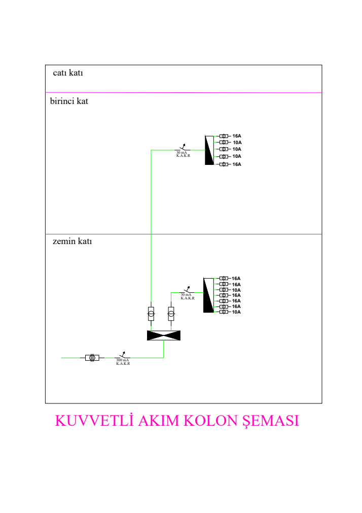
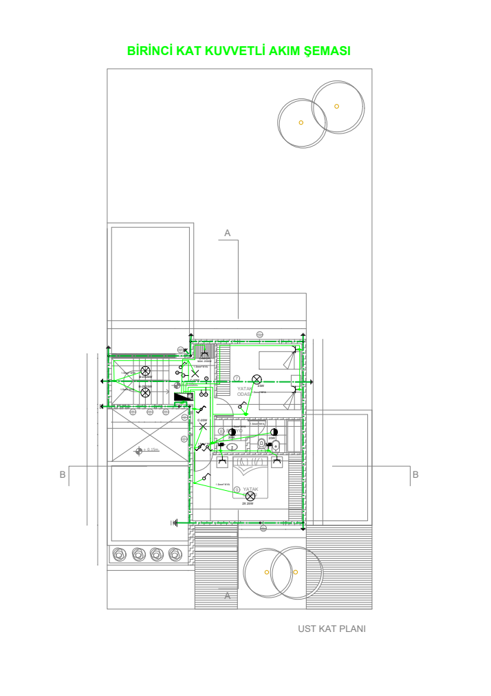
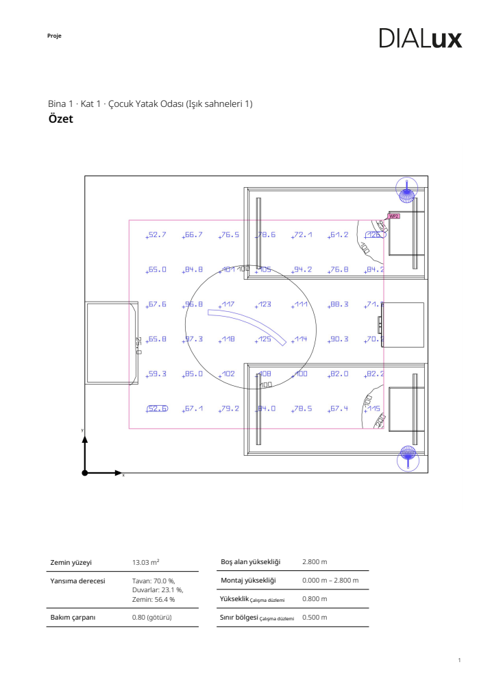
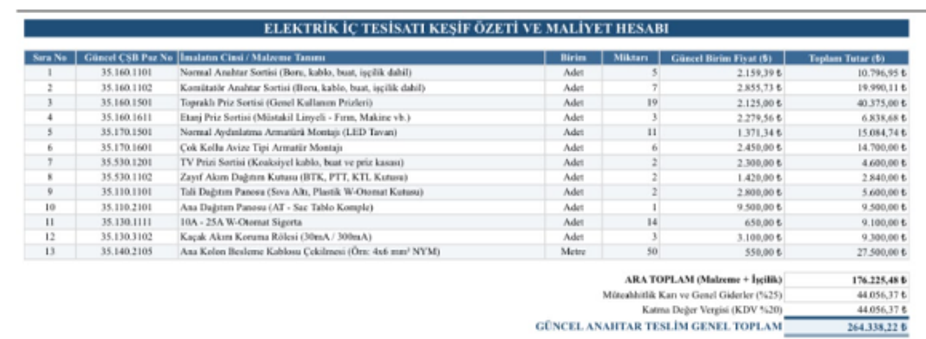

# Residential Building Electrical Project

Complete electrical installation project for a residential building (ground floor, first floor, attic), prepared for the Lighting Technology & Electrical Installation course at Yıldız Technical University, 2025. Team project with **Onur Yıldız**. Drawings and calculations are in Turkish, following Turkish installation regulations.

| What | Tool |
|---|---|
| Site plan, power and low-current floor plans, riser diagrams, grounding plan | AutoCAD |
| Load schedule, phase balancing, voltage-drop and current-capacity checks | Calculation tables |
| Bill of quantities and cost estimate | Unit prices from the official price list |
| Room lighting design and illuminance calculation | DIALux evo |

**Files:** [`building-electrical-project.pdf`](building-electrical-project.pdf) (full project, 19 pages) · [`building-electrical-project.dwg`](building-electrical-project.dwg) (AutoCAD drawings)

## Power riser diagram

Main supply through a 300 mA residual-current device, then one sub-distribution board per floor, each behind its own 30 mA RCD, with 10 A lighting and 16 A socket circuits.

## First-floor power and lighting plan

## Lighting calculation (DIALux evo)

Illuminance grid on the work plane of a 13.03 m² bedroom, lit with 23 W LED pendant luminaires (1587 lm each), maintenance factor 0.80.

## Bill of quantities and cost estimate

13 installation items from switch and socket outlets to distribution boards, RCDs and the main feeder cable; turnkey total 264,338 TL including contractor overhead and VAT.

## Contents of the full PDF

Symbol legend · site plan · power riser diagram · power floor plans · load schedule and voltage-drop calculation · telephone, TV and doorbell riser diagrams · low-current floor plans · grounding plan · luminaire data sheet · DIALux results · cost estimate
